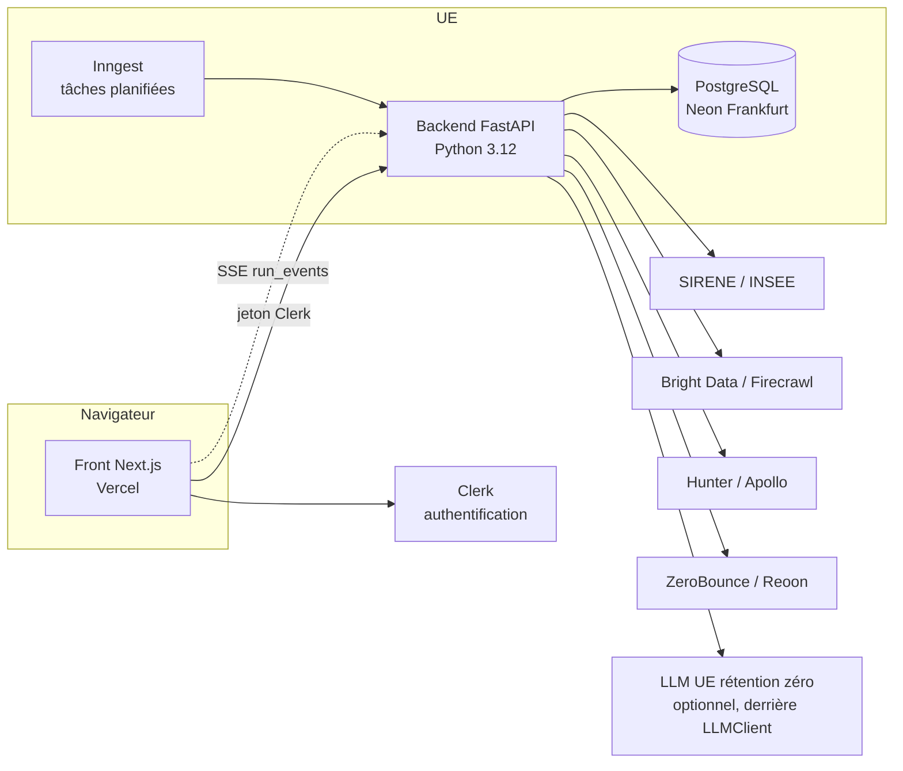

# 01 — Architecture

## Vue d'ensemble

## Principes
1. **Chaque source externe est derrière une interface** (voir `06-interfaces-contrats.md`) : on peut changer de fournisseur sans toucher au reste.
2. **Pipeline en étapes séparées**, chacune idempotente (clé : SIREN + étape).
3. **Cache partagé** des fiches entreprises (données publiques, avec provenance, date, TTL) + **données privées par utilisateur** (profil, préférences, scores, statuts).
4. **Déclenchement par l'utilisateur** : pas de pré-crawl massif. Un job quotidien Inngest sélectionne les recherches `next_run_at <= now`.
5. **Enrichissement par paliers** : gratuit pour tous les candidats (SIRENE) → léger pour les ~5 retenus (site, page carrières) → coûteux seulement au clic (contact, email).
6. **Observabilité** : chaque étape écrit dans `run_events` ; coût et échecs mesurables.
7. **Mode sans IA toujours fonctionnel.**

## Flux d'une exécution de recherche
1. Le job planifié sélectionne les recherches dues (statut actif, quota de l'admin, budget global non épuisé).
2. **Découverte** : `CompanyDiscovery` (SIRENE) selon préférences → entreprises candidates (filtres : NAF, zone, taille ; exclusion des entreprises individuelles et des entreprises déjà vues/ignorées/contactées).
3. **Fiches** : upsert dans `companies` (SIREN unique) ; statut `pending → ready/stale/failed`.
4. **Pré-tri par règles** (`Matcher` règles) : score + `score_breakdown`.
5. **Retenir N** (quota, ex. 5) ; **enrichissement léger** : `WebsiteFinder` puis `PageFetcher` (site, page carrières, signaux).
6. *(Couche IA, si activée et validée)* **jugement LLM** sur la shortlist (~10) avec **profil structuré uniquement** + texte public de l'entreprise.
7. Enregistrer `search_results` (rang, statut `proposée`, explication) ; mettre à jour `next_run_at`.
8. À tout moment, l'étudiant clique « Voir le contact » → tâche à la demande : `ContactFinder` puis `EmailVerifier`.

## Cascades (s'arrêter au premier résultat fiable)

| Besoin | Cascade |
|---|---|
| Entreprises | API Recherche d'entreprises (SIRENE) → API INSEE Sirene |
| Site web, téléphone | Bright Data (Google Maps) → domaine deviné + contrôle DNS/HTTP (le site doit contenir le nom ou la ville) |
| Lecture de pages | Firecrawl → requête HTML simple |
| Contact RH | Pages équipe/carrières → mentions légales/contact → registre (dirigeants, limité) → Hunter.io → Apollo |
| Email | Publié → motif inféré (3 candidats max) → Hunter.io → Apollo → vérification |
| Vérification | Syntaxe + MX (interne) → ZeroBounce (endpoint UE) → Reoon |

Corrections par rapport à l'outil open source d'origine : arrêt au premier résultat fiable, provenance conservée, emails de fournisseurs **revérifiés**, **disjoncteur** par fournisseur avec alerte, cascade et budgets **configurables depuis l'admin**. Pas de repli par scraping de moteurs de recherche.

## Anonymisation et LLM (couche conditionnelle)
Extraction locale du texte → suppression des sections inutiles (loisirs, associatif, infos personnelles) → règles + Presidio/spaCy → **aperçu étudiant** → LLM (rétention zéro, UE) → profil structuré (Pydantic) → **validation étudiant** → suppression du texte. Portes de décision : voir `07-evaluation.md`.

## Progression en direct
Le backend écrit des lignes dans `run_events` ; un endpoint **SSE** les envoie au navigateur ; reprise après coupure via `Last-Event-ID` (la connexion peut être coupée par la plateforme).

## Isolation et sécurité
Jeton Clerk vérifié **à chaque requête côté backend** ; couche d'accès aux données exigeant `user_id` ; test d'isolation ; ensuite RLS PostgreSQL en seconde ligne de défense. Tables partagées (entreprises, contacts) : lecture seule pour les utilisateurs.

## Structure du dépôt (monorepo)
Voir `02-stack-et-conventions.md`.
